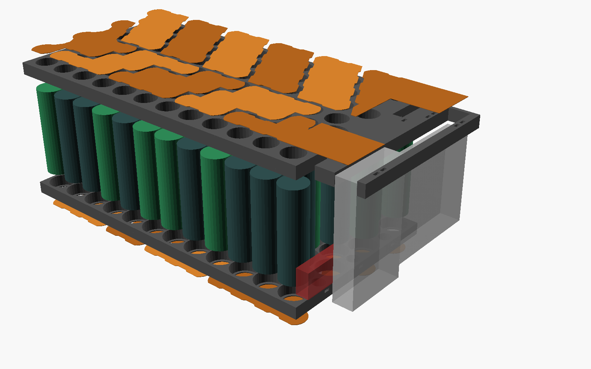
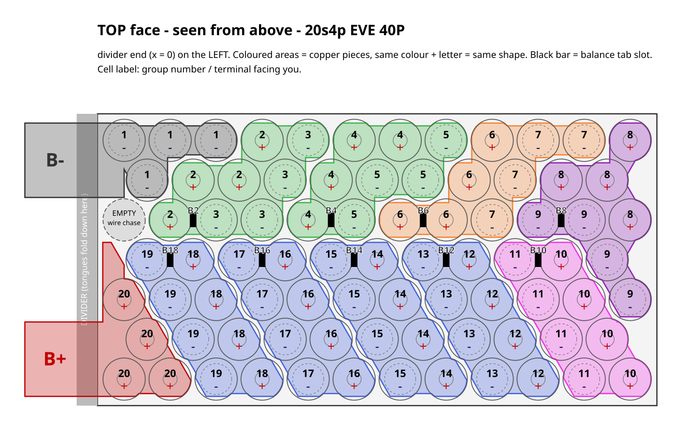
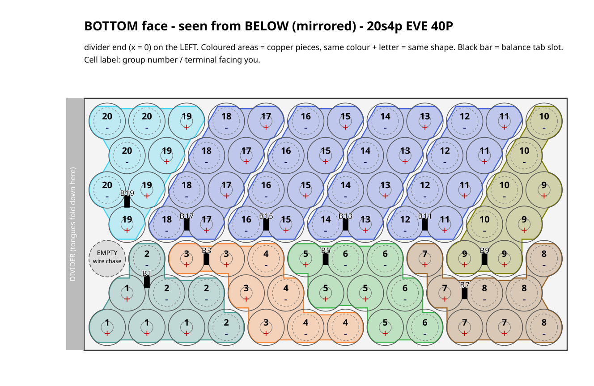
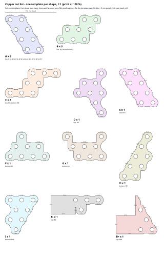
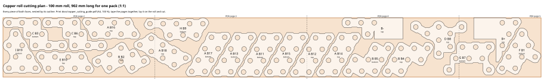
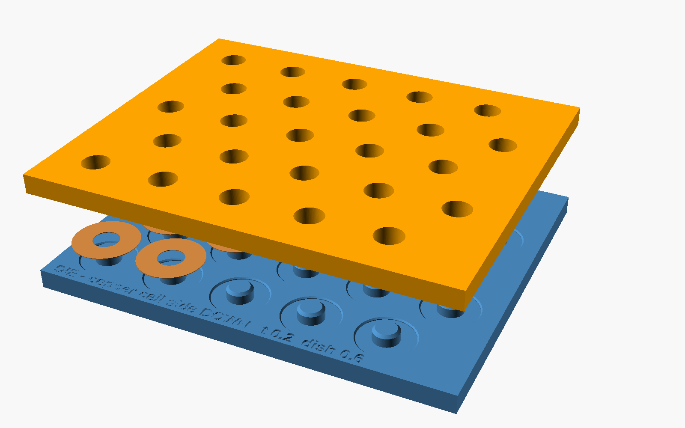
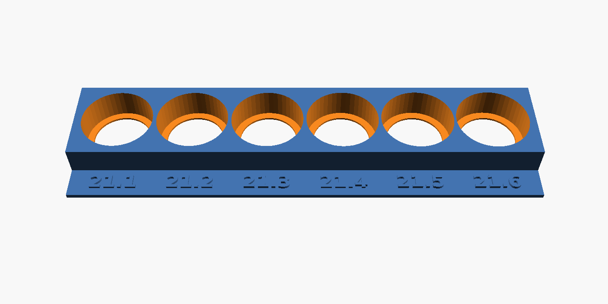
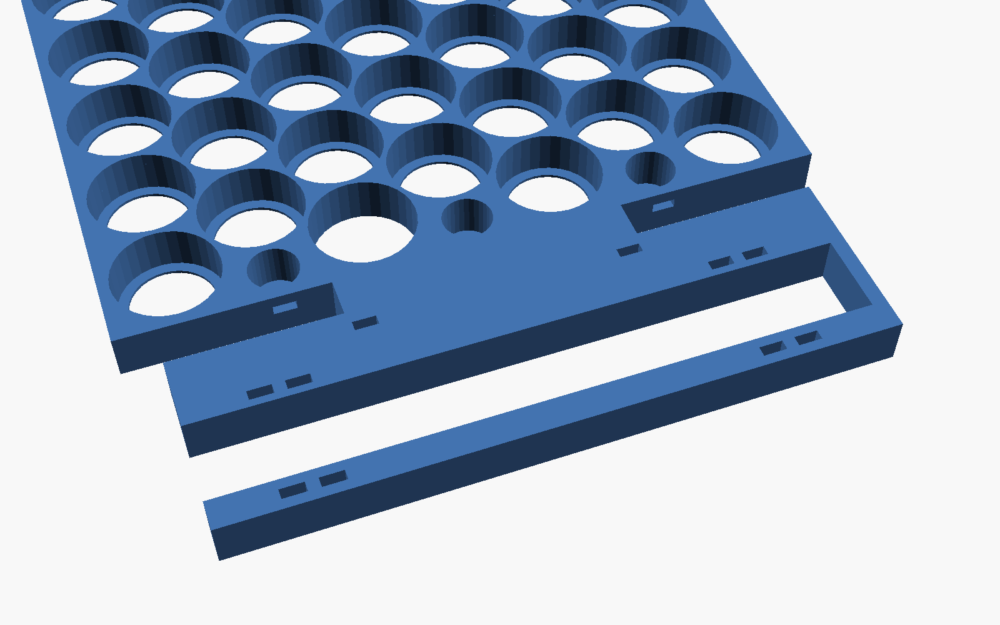
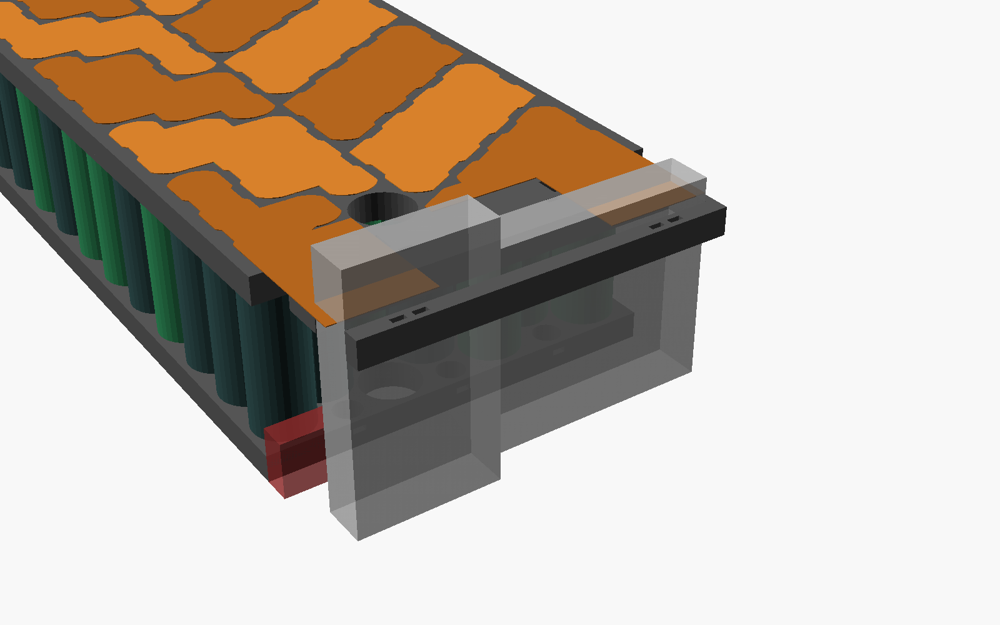

# MaxG3Cellholder

Cellholder for a custom 20s4p battery for the Segway Ninebot Max G3 without cutting the divider in the deck compartment.

* **Cells:** 80 × EVE INR21700-40P (Ø21.15 ±0.10 mm, 70.15 ±0.15 mm)
* **Configuration:** 20s4p, 72 V nominal / 84 V full
* **Envelope:** 141 × 270 mm footprint. Holder + cells are **71.8 mm** tall, which leaves ~9 mm of the 81 mm for copper, nickel, fish paper and heat shrink.
* **Placement:** the pack sits in front of the deck divider. The **BMS (ANT 24ZHE6-24S-220A) stands upright on the other side** of the divider, held by a dock that is **part of the top holder half**. Every lead and balance wire leaves the pack at the divider end.
* **Printed parts:** only what's needed. Just the two holder halves. The top one includes the BMS dock. No cover plates, no separate BMS holder.



---

## 1. What's in the repo

| Path | What it is |
|---|---|
| `stl/holder_bottom.stl`, `stl/holder_top.stl` | Cell holder halves, one piece each. Bottom is 270 mm long; top with BMS dock is 315 mm, so it needs a big bed. |
| `stl/holder_*_a.stl` / `_b.stl` | **The same halves split in two, for normal beds.** Every part fits a 256 × 256 bed (largest: `holder_top_a`, 214 × 141 mm, with the BMS dock). The two parts **lock together through 7 shared cell sockets** (§7). |
| `stl/copper_press_die.stl`, `stl/copper_press_punch.stl` | **Copper press** (§2): presses a dish into the copper over every cell so it drops into the welding window and sits on the cell. 128 × 105 mm, fits every piece. `copper_press_test_*` = 1-cell version to test first |
| `docs/copper_cutting_guide.pdf` | **Print this to cut the copper:** black-and-white A4 cutting guide at 1:1. One page per section of the roll: lay it on the square end of the copper, cut out the pieces, cut straight across, next page. No taping pages together. Plus 1:1 placement maps of both faces |
| `docs/copper_cutlist.svg` | **Copper cut list:** every distinct copper shape once, 1:1, with count, edge lengths and punch holes |
| `docs/copper_roll_plan.svg` | Every copper piece nested on a **100 mm wide roll** (the same plan as the PDF, in one picture) |
| `docs/copper_top.svg`, `docs/copper_bottom.svg` | 1:1 position of every copper piece on each face, with punch holes, tab flaps and tongue fold lines |
| `docs/wiring_top.svg`, `docs/wiring_bottom.svg` | Wiring diagrams: group numbers, cell polarity, copper pieces and balance taps |
| `docs/layout.md` | Cut list table, plus every group, cell and copper piece |
| `scad/cellholder.scad` | Parametric OpenSCAD model: holder halves with BMS dock, tolerances, BMS size |
| `scad/copper_press.scad` | Parametric copper press (copper thickness, dish depth) |
| `scad/layout_data.scad` | Generated layout data (do not edit by hand) |
| `generator/layout.py` | Generates the layout, copper pieces, diagrams and templates |

Coordinates used everywhere:

* **x** runs along the 270 mm length. **x = 0 is the divider end of the pack.**
* **y** runs across the 141 mm width. **y = 0 is the side wall the screw post's 80 mm is measured from.**
* **z** is up from the deck floor.

---

## 2. Layout and copper




The footprint fits a staggered grid of 7 rows (12/11/12/11/12/11/12) at 22.2 mm pitch. That makes **81 slots for 80 cells**. The spare slot is left empty at the divider end and doubles as a wire chase (§4).

The layout follows a proven build: **3-row blocks in rows 5–7, slanted bands in rows 1–4.** The copper pieces are the same as in that build, and so are B− (next to the empty slot) and B+ (the band corner).

* **Rows 5–7:** the series path runs **G1 → G9** away from the divider in short 3-row diagonal groups (5–7 cell contacts). The copper pieces there are 3-row blocks.
* **Rows 1–4:** every 4p group is a **diagonal line of 4**, one cell per row. Two neighbouring diagonals sit side by side along their whole length (7 cell contacts). So every copper piece there is the same **slanted band**, 2 cells wide and 4 rows tall. The path comes back **G10 → G20** to the divider.

**No two consecutive groups ever sit end to end in a row.** That means **single-layer copper everywhere, no double copper**:

* The narrowest copper bridge between two groups is **~63 mm** (cell-outline copper, below).
* An end-to-end joint is only ~14 mm.

| Part of the pack | Groups | Pattern |
|---|---|---|
| Divider end, rows 6–7 | **G1** (**B−**) | Next to the wire chase |
| Rows 5–7 | **G2 → G8** | 3-row diagonals, away from the divider |
| Far end | **G9** | Takes the far-end cells of rows 3–5 |
| Rows 1–4 | **G10 → G19** | Diagonals, back to the divider |
| Divider end, rows 1–4 | **G20** (**B+**) | Corner triangle |

### Copper pieces



* **Cell outlines:** every piece follows its cells, like the reference build. It is a ring of copper around each cell (20 mm across, the welding window is 17 mm) with a 14 mm bridge to each neighbouring cell of the piece.
  * Electrically this costs little: the narrowest joint is still **~63 mm** of copper across.
  * The scalloped edges let the pieces lock into each other on the roll, which is what makes them fit a 1 m roll (below).
* **Rows 1–4:** every band is the same piece (shape A). **Rows 5–7:** the 3-row blocks.

| Shape | Count | What it is |
|---|---|---|
| **A** | **8** | Slanted band, 2 diagonals of 4 cells |
| **B** | **3** | 3-row block, 8 cells |
| **C** | **2** | 3-row block, 8 cells (other split) |
| D–I | 1 each | Far-end and divider-end pieces |
| **B−**, **B+** | 1 each | With a **36 × 35 mm lead tongue** (main leads, §5) |

`docs/copper_cutlist.svg` has a 1:1 template for each shape. To go back to full-area pieces with straight cuts, set `COPPER_STYLE = "full"` in `generator/layout.py`.

**How to prepare the copper:**

* **Punch holes:** there's one 8 mm circle over every cell. Punch a hole there, lay the nickel strip over the copper, and weld the nickel to the cell through the hole and to the copper around it. Change `PUNCH_D` in `generator/layout.py` if your punch is a different size. The hole must be smaller than the cell's positive cap.
* **Cells are recessed 0.6 mm:** each cell stops against a thin lip 0.6 mm below the holder face. **Press a dish into the copper over every cell** with the copper press (below): the dish drops into the 17 mm welding window and sits right on the cell, and the rest of the copper lies flat on the holder. The dishes also lock each piece in place, so it can't slide while you weld. The nickel then only has to bridge the copper thickness through the hole.
* **Cutting guide: one pack uses 90 cm of the 100 mm roll.** Print `docs/copper_cutting_guide.pdf` on A4 in black and white, at **100 % / "Actual size"** (not "fit to page"). Check the 100 mm bar with a ruler.
  1. **Pages 2–5 are the roll, 1:1, one section per page.** No piece crosses from one page to the next, so the pages are never taped together. Do them in order, one page at a time:
     * Cut the page along its **START** line and the two thick **ROLL EDGE** lines. That leaves a paper strip exactly as wide as the copper.
     * Lay it on the copper flush with the copper's square end and both edges, and tape or glue-stick it down.
     * Cut out every piece along its outline, paper and copper together.
     * Cut the copper straight across at the dashed **CUT** line. That gives the square end for the next page.
  2. Punch 8 mm at every circle (+ marks the centre), and cut the 3 sides of each small **TAB** rectangle (§6). The B− / B+ tongues fold along the dashed **FOLD** line.
  3. Leave the paper on until the piece is placed. Each label says the piece (B0–B20) and the face. Pages 6–7 are 1:1 maps of both faces showing where each piece goes.

  All 21 pieces are nested by their real outlines, turned in 30° steps and either side up, with 1 mm between cut lines. Each page is filled with as much copper as fits (sections of 252, 242, 249 and 154 mm). That leaves **~10 cm of the 1 m roll spare**.

  

  This is the whole roll, section by section, as the PDF prints it. The dashed lines are the straight cuts across the roll between the pages.
* **Gaps:** neighbouring pieces have a 2.5 mm gap. The generator checks that no copper ever comes within 10 mm of another group's cell centre.

### Copper press: a dish over every cell



Two printed plates. The **die** (blue) has a pocket at every cell position with a locating pin in the middle. The **punch** (orange) has a matching boss over each pocket and a hole for each pin.

* **It fits every piece.** All the copper pieces sit on the same cell grid, and the 5 × 5 grid covers the largest one (checked for all 21 pieces, either side up).
* **It lines itself up.** The 8 mm hole you punched over each cell drops over its pin, and the same pins guide the punch onto the die. Pockets with no copper over them don't matter.
* **Every dish is the same depth.** The boss squeezes the copper down onto the pocket floor, so the dish's underside ends up exactly `dish_depth` (0.6 mm, = the cell recess) below the flat copper. The dish is 16.6 mm across, so it drops into the 17 mm window.

How to use it:

1. **Measure your copper thickness** and set `copper_t` in `scad/copper_press.scad` (default 0.2 mm). Re-export with `sh scad/export.sh`. This sets the clearance between boss and pocket.
2. Print **`copper_press_test_die` + `copper_press_test_punch` first** (1 cell, a few minutes). Press one punched disc of your copper and drop it into a cell window of the holder over a cell:
   * the dish should touch the cell while the flat part sits on the holder face;
   * **springs back and doesn't reach the cell:** raise `dish_depth` by 0.1 mm;
   * **lifts the copper off the holder face:** lower it.
3. Print `copper_press_die` + `copper_press_punch` (128 × 105 mm each).
4. **For each piece, after punching the 8 mm holes:** lay it on the die with the side that faces the cells **down**, every hole over a pin. Put the punch on top, bosses down. Squeeze evenly in a vise or with two clamps, or put a wood block on top and give it a few mallet blows. Big pieces like B− / B+ can hang over the edge; the tongue stays flat.
5. Press **before** soldering the balance wire and the main lead, so heat doesn't soften anything near the press.

**Other things to know about the layout:**

* **B− (G1)** and **B+ (G20)** both end at the divider end, on the **top** face.
* Copper pieces:
  * **Top face:** B0 (G1, main −), then B2, B4 … B18, then B20 (G20, main +). That's 11 pieces.
  * **Bottom face:** B1, B3 … B19. That's 10 pieces.
* The balance tap number equals the copper piece number. Taps B0–B20 go to BMS balance pins 0–20 (B0 = B−, B20 = B+).
* **Voltages:** neighbouring copper pieces are at most 18 groups apart (~76 V). The big steps are all along the line between rows 4 and 5, on the divider half of the pack. Lay fish paper over each face before wrapping, with an extra strip of kapton along the line between rows 4 and 5.
* **No double copper:** every joint is a single layer. The weakest joints are in the 3-row blocks (5 cell contacts, ~63 mm of copper across).

To change the layout, edit `GROUP_PATTERN` in `generator/layout.py` and run it again (§10).

---

## 3. Stack-up (height budget 81 mm)

| Layer | mm |
|---|---|
| Fish paper / foam under the pack | your choice |
| Copper + nickel, bottom | ~0.4 |
| Cell recess (thin end-stop lip) | 0.6 |
| Cell (70.15 + 0.15 tolerance + fish-paper ring) | 70.6 |
| Cell recess, top | 0.6 |
| Copper + nickel, top | ~0.4 |
| **Total without wrap** | **~72.6** |

* **Holder halves:** each is 9.6 mm tall, with 9 mm deep sockets. Between the halves the cells are bare, over a 52.6 mm gap.
* **Bore:** Ø21.2 mm, picked with the fit test strip (§7): the cells press in firmly by hand. That leaves a 1.0 mm wall between neighbouring cells. On a different printer, print the test strip again and set `cell_bore` in **both** `scad/cellholder.scad` and `generator/layout.py`.
* **Welding window:** Ø17 mm, the opening in the end stop over every cell.

---

## 4. Deck features

### Divider (20 mm tall, 10 mm wide, full width)

The pack's x = 0 face sits against the divider. Nothing passes under or through the divider, so the 0.5 mm indent under it doesn't matter. Everything that goes to the BMS leaves the pack **above z = 20 mm** at the divider end and goes over the divider:

* **Top balance wires** run over the top face, under the fish paper, to the divider end.
* **Bottom balance wires** run under the bottom face to the **wire chase**: the empty cell slot at the divider end, open top to bottom. The wires rise inside it and leave sideways through the open gap between the holder halves, above the divider.
* **Main leads:** see §5.

### Screw post (80 mm from the side wall, 10 mm tall, just in front of the divider)

The post is on the **BMS side** of the divider (`post_side = "bms"`), so the BMS simply stands just behind it (§8).

* If it turns out to be on the **pack side**, set `post_side = "pack"`. The bottom holder half then gets a Ø12 × 11 mm pocket, and the empty cell slot is placed right over the post.
* If the 80 mm is measured from the **other** side wall, set `POST_FROM_SIDE = 141 - 80` (= 61) in `generator/layout.py`. The whole pattern mirrors automatically.

**Measure before you print:**

* post diameter (assumed Ø10)
* distance from the divider (assumed centre 6 mm)
* which side wall the 80 mm is measured from

---

## 5. Main leads (B−, B+): solder first, then weld

You can't solder to the copper once it's welded: the copper soaks up the heat and cooks the cells. So the leads go onto **tongues that stick out past the end of the pack**, and you solder them on the bench before any cell is touched.

1. Cut the **B−** and **B+** pieces from the cut list **with the tongue**. Each tongue is 36 mm wide and runs **35 mm** past the x = 0 edge (dashed fold line on the template). A doubled tongue (two layers of copper) makes the joint even stronger.
2. **On the bench, with no cells near it:** tin the tongue and solder the lead (10 or 12 AWG silicone) along the outer ~20 mm. A 100 W+ iron or a small torch makes copper easy. Let it cool and slide heat shrink over the joint.
3. Pre-bend the tongue 90° **downwards** at the x = 0 edge.
4. Lay the piece on its cells, add the nickel and weld. The joint hangs down the divider-end face of the top holder half, **above the divider**.
5. **Strain relief:** each tongue folds down through a notch in the BMS dock arm. Zip-tie the lead through the hole pair beside the notch, or through the tie slot in the end wall behind it (y = 109 for B−, y = 32 for B+). That way the lead's weight pulls on the plastic, not on the welds.

**No-solder alternative:** crimp a ring lug on the lead and bolt it to the tongue with M5 or M6 (spring washer + nyloc), outside the pack.

## 6. Balance tabs

There is one tab per copper piece, at the small rectangle on the templates. It sits over plastic between the cells, never over a cell terminal.

1. On each copper piece, cut a **5 × 7 mm U-flap** at the marked spot.
2. **Solder the balance wire (22–24 AWG silicone) to the flap on the bench**, before welding. Then weld the piece. Solder the B0 and B20 balance wires to the main-lead tongues in the same bench step.
3. Run the wires to the divider end:
   * **Top face:** lay the wires flat on the top face.
   * **Bottom face:** lay them flat on the bottom face and route them up through the wire chase.
4. Fix them with kapton tape, then cover each face with fish paper.
5. Put a fuse or PTC on each balance lead at the connector end if your BMS harness doesn't already have them.

---

## 7. Printing

### What to print

It's only the two holder halves. The BMS dock is part of the top half. Plus, as a tool, the copper press (§2):

| Tool | Size (mm) | Notes |
|---|---|---|
| `stl/copper_press_test_die.stl` + `_test_punch.stl` | 28 × 28 | Print first and test one disc (§2) |
| `stl/copper_press_die.stl` + `_punch.stl` | 128 × 105 | PLA is fine for this (it's a tool, not in the deck). 0.1–0.12 mm layers for crisp 0.6 mm pockets, 4 walls, 30 %+ infill. Print as exported: die pins up, punch bosses up |

| Your bed | Print these |
|---|---|
| **≥ 315 × 141 mm** | `holder_bottom.stl` + `holder_top.stl` (one piece each) |
| **Smaller, e.g. 256 × 256 mm** (Bambu, Prusa, Ender …) | the four split parts below |

The split parts are all 9.6 mm tall:

| File | Size (mm) |
|---|---|
| `stl/holder_bottom_a.stl` | 146 × 141 |
| `stl/holder_bottom_b.stl` | 157 × 141 |
| `stl/holder_top_b.stl` | 135 × 141 |
| `stl/holder_top_a.stl` (has the BMS dock) | 214 × 141 |

### Print order

0. **`stl/bore_test.stl` first: the cell fit test** (137 × 35 mm, ~15 cm³, about half an hour).
   * It's a row of 6 cell holes, **21.1 to 21.6 mm**, built exactly like the holder: same lip, depth, spacing and circle resolution. Each hole has its size printed on the tab next to it.
   * Push a cell into each hole and pick the one where it goes in **firmly by hand and doesn't fall out** when you turn the strip over.
   * Set that number as `cell_bore` in `scad/cellholder.scad` **and** `BORE_D` in `generator/layout.py`, then re-run `python3 generator/layout.py` and `sh scad/export.sh`. (Or just tell Claude the number.)

   
1. `holder_bottom_a`. Check a few cells in it before printing the rest.
2. `holder_bottom_b`. It locks to `_a` through the key cells (see below).
3. `holder_top_b`.
4. **`holder_top_a` last.** It places the BMS slot, so check these first (§4, §8):
   * the screw-post position
   * at least ~91 mm of height past the divider

### Settings

* **Material: PETG, ASA or ABS. Not PLA** (it creeps and softens in a hot deck).
* 0.2 mm layers (the 0.6 mm lip under each cell is then exactly 3 layers), 3 walls, 15–25 % infill.
* **Orientation:** as exported, flat face down. **No supports** for any part. The BMS dock is a flat arm in the same layer as the top half, with only vertical holes.
* **Split parts:** they join mechanically, so no glue or pins are needed (see below).

### How the split parts lock together


The seam doesn't run between cells. It runs **through a column of cells**, one **key cell** per row (7 per half). In the bottom half they're at x ≈ 124 / 135 mm, in the top half one column further, at x ≈ 146 / 157 mm.

* **How a key cell is split:** its socket is cut in half across the centre. One half belongs to part `_a`, the other to `_b`.
* **Alternating halves:** row by row, `_a` gets the upper half, then the lower half, and so on.
* **Why it locks:** once a key cell is pushed in, it sits in a half-socket of **both** parts. Each key cell acts as a 21 mm dowel, and because the halves alternate, the parts can't slide apart in any direction across the pack.
* **Assembly:** lay `_a` and `_b` side by side on the table, close the seam, and **push the 7 key cells in first**. After that, fill the rest.
* **Offset seams:** the top and bottom seams are a column apart, so they never line up. Each seam is backed by a solid stretch of the other half, like staggered joints in brickwork, and the pack has no weak line to fold along.
* **Extra security:** a drop of CA glue along the seam keeps the parts together while you handle them without cells. The welded copper and nickel, which bridge the seam on both faces, make the joint permanent.

## 8. BMS dock (built into the top holder half)



The ANT BMS (125 × 90 × 16 mm) **stands upright on its long edge** on the deck floor, parallel to the divider, just behind the screw post. The **top holder half** has a flat arm that reaches over the divider (it sits at 62–72 mm height, the divider is only 20 mm tall) with a **slot the BMS drops into**. It only takes about **45 mm of deck length** past the divider, and there is no separate part to print or fix down.



* **Height:** the BMS is 90 mm tall standing, so make sure the space past the divider has at least ~91 mm.
* **Connector end** (wide 90 mm head): the slot is **open** there, so the balance connectors stay free.
* **Narrow end** (70 mm section with the power leads): a cross bar closes the slot. That section sits 10 mm off the floor, so the lower leads have room to bend outwards.
* **Hold-down:** two zip ties, one near each end, through the hole pairs in both rails and over the BMS's top edge.
* **Lead notches:** the arm has notches at the pack end, so the **B− / B+ tongues still fold down** over the end of the pack. A hole pair beside each notch takes a zip tie around the lead (strain relief).
* **Printing:** the arm is the same 9.6 mm slab as the half, so it prints flat with it.

Settings in `scad/cellholder.scad`:

* `bms_head_at`: which side of the deck the connector end faces (`"y0"` or `"y1"`)
* `bms_y`: where the BMS sits across the deck
* `bms_*` sizes, if you change BMS
* `bms_dock = false` removes the dock

Then run `sh scad/export.sh`.

## 9. Assembly order

1. Insert the cells into the **bottom** half, following `docs/wiring_bottom.svg`. With the split parts, put the 7 key cells in first to lock `_a` and `_b` together (§7). Then fit the **top** half the same way.
   * **Top** terminals: G1 is **−** up, G2 is **+** up, and so on, alternating.
   * Before you weld anything, check every cell's polarity against the diagrams with a meter.
2. Fit fish-paper rings on the positive ends.
3. **Bottom face:**
   * Pre-solder the balance wires to the flaps of B1 … B19.
   * Lay the punched and pressed copper pieces (dishes into the windows). Page 7 of the cutting guide (or `docs/copper_bottom.svg`) shows where each one goes, drawn as seen from below.
   * Weld the nickel through the holes.
   * Tape the wires and route them into the chase.
4. **Top face:**
   * Pre-solder the B− and B+ leads and the B2 … B18 balance wires.
   * Lay the pressed copper (page 6 of the cutting guide, or `docs/copper_top.svg`), weld the nickel, fold the tongues down and zip-tie the leads.
5. Measure each tap against B0 before plugging into the BMS. Each step should be ~3.6–4.2 V.
6. Fish paper over both faces, then wrap the pack (foam + heat shrink). Make sure the controller is rated for **84 V** before connecting.

---

## 10. Regenerating / customising

```sh
pip install shapely cairocffi       # one time (cairocffi: the PDF cutting guide)
python3 generator/layout.py         # layout -> scad/layout_data.scad + docs/*.svg + docs/*.pdf + docs/layout.md
sh scad/export.sh                   # all STLs into stl/ (OpenSCAD 2021.01+)
openscad scad/cellholder.scad       # preview, set part = "assembly" / "exploded"
```

When the copper pieces change, the roll nesting search runs again (a few minutes). Its result is cached in `generator/roll_nest.json`, so later runs take about a second.

Parameters live in two places:

* **`generator/layout.py`:**
  * envelope (`PACK_L`, `PACK_W`) and `PITCH`
  * the screw post (`POST_FROM_SIDE`, `POST_FROM_DIVIDER`, `POST_D`, `POST_H`)
  * copper gap, punch hole size (`PUNCH_D`), lead tongue size (`LEAD_W`, `LEAD_LEN`) and roll width (`ROLL_W`)
  * copper style (`COPPER_STYLE`, `RING_R`, `BRIDGE_W`) and roll nesting (`KERF`, `NEST_ANGLES`, `NEST_TRIES`)
  * the group pattern (`GROUP_PATTERN`)
* **`scad/cellholder.scad`:**
  * cell size and bore, welding window, cell recess, socket depth, tie slots
  * screw post side (`post_side`)
  * BMS size and dock settings
